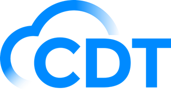

## About

Eclipse CDT Cloud is an [Eclipse Foundation project](https://projects.eclipse.org/projects/ecd.cdt-cloud) building open source components and sharing best practices for customizable C/C++ development tools. Our goal is to make it easier to assemble tools for the browser or desktop that fit your needs.

The [CDT Cloud Blueprint](https://github.com/eclipse-cdt-cloud/cdt-cloud-blueprint) brings language support, debugging, memory inspection, and trace visualization together in an example built on Eclipse Theia. Explore the [project website](https://eclipse.dev/cdt-cloud/) to see it in action.

## Join the community

Whether you are trying a component, reporting a bug, improving documentation, or contributing code, you are welcome here.

- Join our [monthly community meeting](https://github.com/eclipse-cdt-cloud/cdt-cloud/wiki/CDT-Cloud-Meetings). The wiki has meeting details, agendas, and notes.
- Ask questions, report bugs, or suggest improvements through GitHub issues in the corresponding repositories. Some repositories also have Discussions, for example [cdt-cloud](https://github.com/eclipse-cdt-cloud/cdt-cloud/discussions).

## Repositories

### Debug

These components connect development tools to GDB and help you inspect memory and device peripherals while debugging. The current debug work is listed on the public [CDT Cloud Debug project board](https://github.com/orgs/eclipse-cdt-cloud/projects/2).

| Repository | Description |
| --- | --- |
| [cdt-gdb-adapter](https://github.com/eclipse-cdt-cloud/cdt-gdb-adapter) | A Debug Adapter Protocol (DAP) implementation for GDB. |
| [cdt-gdb-vscode](https://github.com/eclipse-cdt-cloud/cdt-gdb-vscode) | An extension with the CDT GDB debug adapter for VS Code compatible editors and Theia. Depends on `cdt-gdb-adapter`. |
| [vscode-memory-inspector](https://github.com/eclipse-cdt-cloud/vscode-memory-inspector) | A memory inspector for VS Code compatible editors and Theia. |
| [vscode-peripheral-inspector](https://github.com/eclipse-cdt-cloud/vscode-peripheral-inspector) | A view of device peripheral registers described by SVD files. |

### Trace

Explore the Trace Server Protocol (TSP), its client libraries, and viewer components for analyzing and visualizing traces.

| Repository | Description |
| --- | --- |
| [trace-server-protocol](https://github.com/eclipse-cdt-cloud/trace-server-protocol) | The Trace Server Protocol (TSP) specification. |
| [tsp-typescript-client](https://github.com/eclipse-cdt-cloud/tsp-typescript-client) | A TypeScript client library for TSP. |
| [tsp-python-client](https://github.com/eclipse-cdt-cloud/tsp-python-client) | A Python client library for TSP. |
| [theia-trace-extension](https://github.com/eclipse-cdt-cloud/theia-trace-extension) | Trace visualization for Eclipse Theia. |
| [vscode-trace-extension](https://github.com/eclipse-cdt-cloud/vscode-trace-extension) | A TSP trace viewer for VS Code compatible editors and Theia. |
| [vscode-trace-server](https://github.com/eclipse-cdt-cloud/vscode-trace-server) | An extension that starts and stops a trace server for the trace viewer. |
| [timeline-chart](https://github.com/eclipse-cdt-cloud/timeline-chart) | A timeline chart library for large data sets such as traces. |
| [traceviewer-libs](https://github.com/eclipse-cdt-cloud/traceviewer-libs) | Reusable base and React components for trace viewers. |
| [trace-viewer-examples](https://github.com/eclipse-cdt-cloud/trace-viewer-examples) | Example applications and building blocks for trace viewers. |

### Connectivity

These extensions connect tools to remote debug services and serial devices, including from the browser.

| Repository | Description |
| --- | --- |
| [vscode-websocket-adapter](https://github.com/eclipse-cdt-cloud/vscode-websocket-adapter) | A debug adapter that connects over WebSockets. |
| [vscode-serial-monitor](https://github.com/eclipse-cdt-cloud/vscode-serial-monitor) | A serial monitor for desktop editors and browser editors with Web Serial. |

### Other

Start with the Blueprint for an integrated example, or explore language tooling, shared UI components, and project information.

| Repository | Description |
| --- | --- |
| [cdt-cloud-blueprint](https://github.com/eclipse-cdt-cloud/cdt-cloud-blueprint) | A starter application that integrates CDT Cloud components. |
| [clangd-contexts](https://github.com/eclipse-cdt-cloud/clangd-contexts) | APIs for managing clangd configuration across C/C++ project contexts. |
| [vscode-clangd](https://github.com/eclipse-cdt-cloud/vscode-clangd) | A fork of the clangd extension with support for multiple projects. |
| [vscode-ui-components](https://github.com/eclipse-cdt-cloud/vscode-ui-components) | Shared UI components for CDT Cloud extensions for VS Code compatible editors and Theia. |
| [cdt-cloud](https://github.com/eclipse-cdt-cloud/cdt-cloud) | Project information and the monthly meeting wiki. |
